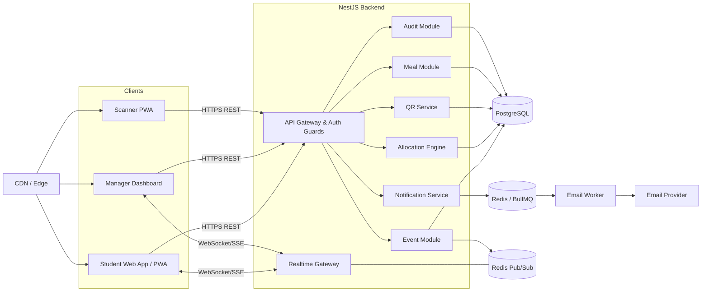
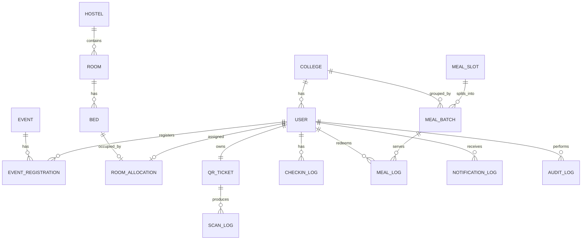
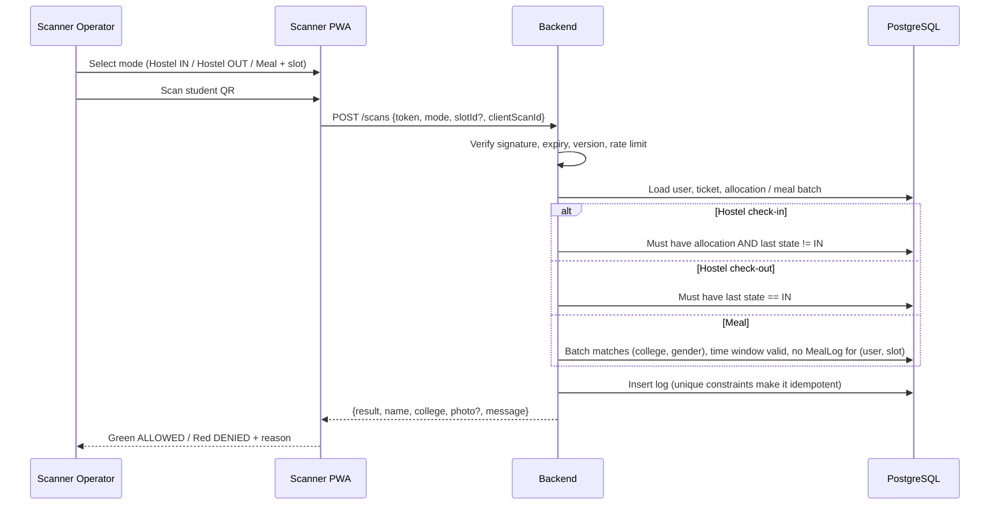
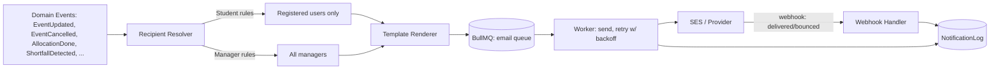

# Technical Requirements Document (TRD)
**Product:** UniFest Manager
**Version:** 1.0

---

## 1. Recommended Tech Stack

| Layer | Choice | Rationale |
|---|---|---|
| **Frontend** | Next.js 14+ (App Router), TypeScript, Tailwind CSS, shadcn/ui, TanStack Query, Zustand | SSR/SEO not critical but routing, DX and PWA support are strong |
| **Scanner / PWA** | `html5-qrcode` or `@yudiel/react-qr-scanner`, Workbox service worker | Browser camera scanning, offline queue |
| **QR Generation** | `qrcode` (server-side PNG/SVG) | Deterministic, lightweight |
| **Backend** | Node.js 20 + NestJS (TypeScript), REST + Server-Sent Events/WebSocket | Modular structure, DI, guards for RBAC |
| **ORM** | Prisma | Typed schema, migrations |
| **Database** | **PostgreSQL 16** | Strong relational integrity, row locks, partial/unique indexes and triggers for hard constraints |
| **Cache / Queue** | Redis + BullMQ | Job queues for email, rate limiting, pub/sub for real-time |
| **Real-time** | Socket.IO (or SSE) backed by Redis pub/sub | Live event updates, dashboards |
| **Email** | Amazon SES (or Resend/SendGrid) + React Email templates | Reliable, cheap at volume |
| **Auth** | JWT (short-lived access) + refresh tokens in httpOnly cookies; Argon2 hashing | Standard and secure |
| **File Storage** | S3-compatible bucket | CSV imports/exports, static assets |
| **Hosting** | Frontend: Vercel (or S3+CloudFront). Backend: AWS ECS Fargate / Railway / Render. DB: RDS or Neon/Supabase Postgres. Redis: Upstash/ElastiCache | Managed and low ops overhead |
| **CI/CD** | GitHub Actions: lint, typecheck, test, migrate, deploy | |
| **Observability** | Sentry, Pino logs, Prometheus/Grafana or Datadog | |
| **Testing** | Vitest/Jest, Supertest, Playwright (E2E), k6 (load) | |

---

## 2. System Architecture



### Module Responsibilities
| Module | Responsibility |
|---|---|
| **Auth** | Signup, login, email verification, RBAC guards (STUDENT, MANAGER, SCANNER, ADMIN) |
| **Event** | CRUD events, registrations, status changes, emits domain events |
| **Allocation Engine** | Group, pack, assign beds, validate constraints, handle overrides |
| **QR Service** | Issue and verify signed tokens, resolve scan context, log scans |
| **Meal** | Slots, batches, eligibility, redemption |
| **Notification** | Subscribes to domain events, resolves recipients, enqueues emails |
| **Audit** | Append-only log of privileged actions |

---

## 3. Data Model

### 3.1 Entity Relationship Diagram



### 3.2 Schema (Prisma-style)

```prisma
enum Role      { STUDENT MANAGER SCANNER ADMIN }
enum Gender    { MALE FEMALE }               // extendable per policy
enum EventType { SPORTS FOLK }
enum EventStatus { SCHEDULED LIVE COMPLETED CANCELLED POSTPONED }
enum MealType  { BREAKFAST LUNCH SNACKS DINNER }
enum ScanContext { HOSTEL_CHECKIN HOSTEL_CHECKOUT MEAL }
enum ScanResult  { ALLOWED DENIED_DUPLICATE DENIED_WRONG_BATCH DENIED_NOT_ELIGIBLE DENIED_INVALID DENIED_EXPIRED }

model College {
  id        String  @id @default(uuid())
  name      String  @unique
  code      String  @unique
  users     User[]
  rooms     Room[]       // rooms currently locked to this college
  batches   MealBatch[]
}

model User {
  id            String   @id @default(uuid())
  email         String   @unique
  passwordHash  String
  name          String
  phone         String?
  gender        Gender
  role          Role     @default(STUDENT)
  collegeId     String?  // null only for ADMIN/MANAGER staff
  college       College? @relation(fields: [collegeId], references: [id])
  emailVerified Boolean  @default(false)
  registrations EventRegistration[]
  allocation    RoomAllocation?
  qrTicket      QrTicket?
  @@index([collegeId, gender])
}

model Event {
  id         String      @id @default(uuid())
  title      String
  type       EventType
  description String?
  venue      String
  startsAt   DateTime
  endsAt     DateTime
  capacity   Int?
  status     EventStatus @default(SCHEDULED)
  registrations EventRegistration[]
  @@index([startsAt])
}

model EventRegistration {
  id       String @id @default(uuid())
  userId   String
  eventId  String
  status   String @default("CONFIRMED")
  @@unique([userId, eventId])
}

model Hostel {
  id     String @id @default(uuid())
  name   String
  gender Gender            // hostel-level designation
  rooms  Room[]
}

model Room {
  id          String   @id @default(uuid())
  hostelId    String
  number      String
  floor       Int
  capacity    Int
  gender      Gender               // inherited from hostel; enforced
  lockedCollegeId String?          // set on first allocation, cleared when empty
  lockedCollege College? @relation(fields: [lockedCollegeId], references: [id])
  beds        Bed[]
  @@unique([hostelId, number])
}

model Bed {
  id     String @id @default(uuid())
  roomId String
  label  String
  allocation RoomAllocation?
  @@unique([roomId, label])
}

model RoomAllocation {
  id          String   @id @default(uuid())
  userId      String   @unique        // one bed per user
  bedId       String   @unique        // one user per bed
  allocatedBy String                  // "SYSTEM" or manager userId
  isOverride  Boolean  @default(false)
  createdAt   DateTime @default(now())
}

model QrTicket {
  id         String   @id @default(uuid())
  userId     String   @unique
  tokenId    String   @unique         // jti embedded in signed token
  version    Int      @default(1)     // bump to invalidate old QR
  issuedAt   DateTime @default(now())
  revokedAt  DateTime?
  scans      ScanLog[]
}

model CheckinLog {                    // hostel state
  id       String   @id @default(uuid())
  userId   String
  type     String                     // CHECK_IN | CHECK_OUT
  scannedBy String
  at       DateTime @default(now())
  @@index([userId, at])
}

model MealSlot {
  id      String   @id @default(uuid())
  date    DateTime
  type    MealType
  batches MealBatch[]
  @@unique([date, type])
}

model MealBatch {
  id        String   @id @default(uuid())
  slotId    String
  collegeId String
  gender    Gender
  startsAt  DateTime
  endsAt    DateTime
  logs      MealLog[]
  @@unique([slotId, collegeId, gender])
}

model MealLog {
  id        String   @id @default(uuid())
  userId    String
  slotId    String
  batchId   String
  scannedBy String
  isException Boolean @default(false)
  at        DateTime @default(now())
  @@unique([userId, slotId])          // one meal per slot, DB-enforced
}

model ScanLog {
  id        String      @id @default(uuid())
  ticketId  String?
  context   ScanContext
  result    ScanResult
  scannedBy String
  deviceInfo String?
  at        DateTime    @default(now())
}

model NotificationLog {
  id        String   @id @default(uuid())
  userId    String
  type      String
  subject   String
  status    String                    // QUEUED | SENT | FAILED | BOUNCED
  eventId   String?
  attempts  Int      @default(0)
  createdAt DateTime @default(now())
}

model AuditLog {
  id        String   @id @default(uuid())
  actorId   String
  action    String
  entity    String
  entityId  String
  reason    String?
  before    Json?
  after     Json?
  at        DateTime @default(now())
}
```

### 3.3 Database-Level Safety Net
Application logic is the first line of defense. The database is the last. Add a trigger or constraint on `RoomAllocation` insert/update that rejects the row unless:

```sql
-- Pseudocode for BEFORE INSERT/UPDATE trigger on room_allocation
-- 1. user.gender = room.gender
-- 2. room.locked_college_id IS NULL OR room.locked_college_id = user.college_id
-- 3. count(allocations in room) < room.capacity
-- On success: set room.locked_college_id = user.college_id if NULL.
-- AFTER DELETE: if room has 0 allocations, set room.locked_college_id = NULL.
```

---

## 4. Allocation Engine

### 4.1 Algorithm (Deterministic, Constraint-First)
```
INPUT: unallocated confirmed students U, rooms R with free beds
1. Partition U into groups G[(collegeId, gender)].
2. Sort groups by size DESC (largest first reduces fragmentation).
3. For each group g:
   a. Candidate rooms = rooms where room.gender == g.gender
        AND (room.lockedCollegeId == g.college OR room.lockedCollegeId IS NULL)
   b. PRIORITY 1: top up partially filled rooms already locked to g.college
   c. PRIORITY 2: use empty rooms, choosing the best fit
        (smallest capacity that fits the remainder, otherwise the largest, to minimize partial rooms)
   d. Assign beds inside a SERIALIZABLE transaction; lock candidate rooms with SELECT ... FOR UPDATE
   e. If beds are insufficient -> mark remainder UNALLOCATED, emit CAPACITY_SHORTFALL alert.
      NEVER place the remainder in a mixed room.
4. Persist results, write audit entries, emit ALLOCATION_COMPLETED.
OUTPUT: allocations, unallocated list with reasons, shortfall report
```

### 4.2 Guarantees
- **Idempotent and incremental:** re-running only handles unallocated students.
- **Atomic per group:** a group's placement either fully commits or rolls back.
- **Dry-run mode:** manager previews results before committing.
- **Override path:** `POST /allocations/override` validates the same rules. Only `ADMIN` can pass `forceException=true`, and a reason is mandatory.

---

## 5. QR Code Generation & Scanning Logic

### 5.1 Token Design
- Each user gets **one** QR (`QrTicket`) at email verification or registration confirmation.
- The QR encodes a compact signed token (JWT/EdDSA or HMAC-SHA256):

```json
{ "sub": "<userId>", "jti": "<tokenId>", "v": 1, "iat": 1760000000, "fest": "<festivalId>" }
```
- The QR holds **identity only**. It carries **no** room, meal or gender data (nothing sensitive if photographed).
- Scan context is determined by the **scanner device's selected mode** (Hostel In/Out or Meal+Slot), chosen by an authorized operator.
- Revocation: bump `QrTicket.version` and invalidate the old `jti`.

### 5.2 Scan Verification Flow



### 5.3 Rules
| Mode | Allowed when | Denied reasons |
|---|---|---|
| Hostel check-in | User has allocation and is currently OUT | No allocation, already IN, wrong hostel gate |
| Hostel check-out | User currently IN | Not checked in |
| Meal | Batch (college+gender) active for slot, grace window respected, no previous redemption | Wrong batch, outside window, already used, not eligible |

- `clientScanId` (UUID per scan attempt) makes retries idempotent.
- Every attempt, allowed or denied, is written to `ScanLog`.
- Meal exception: manager can grant one-time bypass, which is audited and flagged `isException`.

---

## 6. Notification Service Architecture



### 6.1 Recipient Resolution (Core Rule)
| Trigger | Students | Managers |
|---|---|---|
| Event time/venue changed | **Only** users in `EventRegistration` for that event | All managers |
| Event cancelled/postponed | Same, registered only | All managers |
| Event reminder (T-24h, T-1h) | Registered users only | Optional digest |
| New registration / withdrawal | Registrant (confirmation) | Digest or live feed |
| Allocation completed | The allocated student (own room only) | Summary + shortfalls |
| Capacity shortfall / scan anomaly | None | All managers |
| Broadcast | Filter by all / college / gender / event | Sender copy |

### 6.2 Implementation Notes
- Resolver is a pure function: `resolveRecipients(eventType, payload) -> User[]`. This is unit-tested heavily, because it enforces the "only registered events" rule.
- Jobs: exponential backoff (3 to 5 attempts), dead-letter queue, rate limits per provider quota.
- Dedup key `(userId, type, entityId, version)` prevents duplicate emails on rapid edits. Rapid edits within 60s are coalesced into one email.
- Templates are in React Email with plain-text fallback. Sender domain uses SPF, DKIM and DMARC.
- Scheduled reminders use BullMQ delayed or repeatable jobs and are re-scheduled when event time changes.

---

## 7. Real-Time Updates
- On event create/update/status change, the backend publishes to Redis channel `events:{eventId}` and `events:all`.
- The WebSocket/SSE gateway pushes diffs to subscribed clients. Students subscribe to their registered events, and managers subscribe to everything.
- Clients fall back to polling (30s) if the socket drops.

---

## 8. API Surface (Representative)

| Method | Endpoint | Role | Purpose |
|---|---|---|---|
| POST | `/auth/register`, `/auth/login`, `/auth/verify-email` | Public | Auth |
| GET | `/events`, `/events/:id` | Auth | Browse |
| POST/PATCH | `/events`, `/events/:id` | Manager | Create/update |
| POST/DELETE | `/events/:id/register` | Student | Register / withdraw |
| GET | `/me/schedule`, `/me/qr`, `/me/room`, `/me/meals` | Student | Personal data |
| POST | `/allocations/run?dryRun=true` | Manager | Run algorithm |
| GET | `/allocations/matrix` | Manager | Matrix view |
| POST | `/allocations/override` | Manager/Admin | Move student |
| POST | `/scans` | Scanner | Verify QR (hostel/meal) |
| POST | `/meals/slots`, `/meals/batches/generate` | Manager | Meal setup |
| GET | `/meals/live`, `/hostel/occupancy` | Manager | Live counts |
| POST | `/notifications/broadcast` | Manager | Custom email |
| GET | `/audit` | Admin | Audit log |

All endpoints use zod/class-validator DTOs, RBAC guards, and consistent error codes (`ALLOCATION_RULE_VIOLATION`, `QR_EXPIRED`, `MEAL_ALREADY_USED`, ...).

---

## 9. Security & Compliance
- RBAC enforced at controller guard **and** query level (students can only query their own rows).
- Rate limiting on auth and scan endpoints. Account lockout after repeated failures.
- Signing keys in a secrets manager and rotated per festival.
- PII: gender and phone visible to Manager/Admin only, with encryption at rest and TLS in transit.
- Audit log is append-only (no UPDATE/DELETE grants for the app role).
- Dependency scanning (Dependabot) and secret scanning in CI.

## 10. Deployment & Environments
| Env | Purpose |
|---|---|
| `local` | Docker Compose: Postgres, Redis, MailHog |
| `staging` | Mirrors production; seeded with synthetic colleges and hostels |
| `production` | Autoscaled API (min 2 instances), managed DB with PITR backups |

Pre-event checklist: load test (k6) at 3x expected scan rate, backup restore drill, email domain warm-up, scanner device dry-run.
