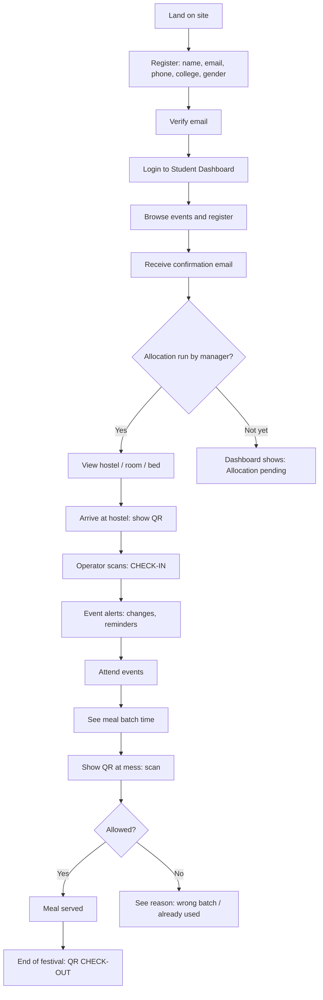
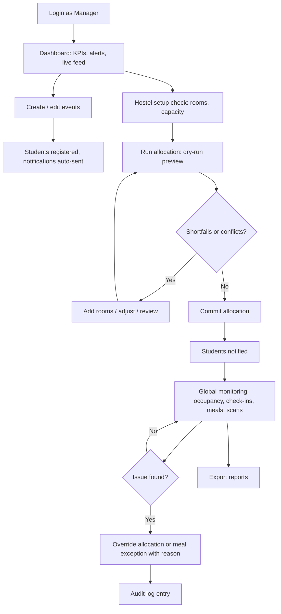
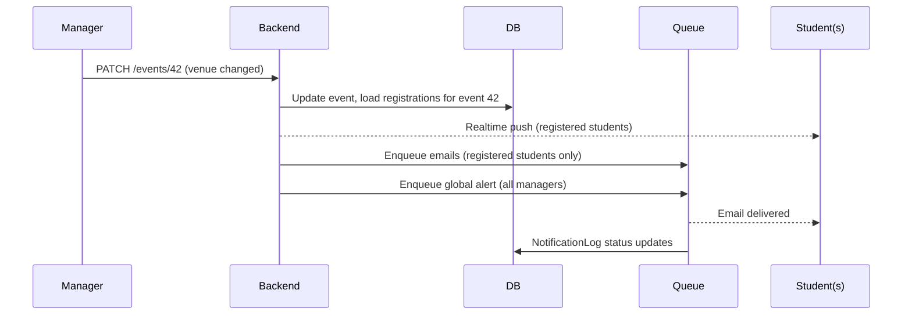

# App Flow & User Journey Map
**Product:** UniFest Manager | **Version:** 1.0

---

## 1. Student Journey

### 1.1 High-Level Flow

### 1.2 Step-by-Step

| Step | Student Action | System Response | Edge Cases |
|---|---|---|---|
| **1. Registration** | Opens signup. Enters name, email, phone, selects **college** from list, selects **gender**. | Validates, creates account (unverified), sends verification email. | Duplicate email shows error. College missing from list shows "Request to add" (goes to Admin). |
| **2. Email verification** | Clicks link or enters OTP. | Marks verified, **issues QR ticket**, redirects to dashboard. | Expired link has a "Resend" option. |
| **3. Event discovery** | Opens Events tab. Filters by day, sports/folk, venue. | Lists events with time, venue, status badge, seats left. | Full events show a waitlist or "Full" state. |
| **4. Event registration** | Taps Register. | Creates registration, sends confirmation email, adds to **My Schedule**. | Overlapping event shows a conflict warning with option to proceed. Past cutoff disables registration. |
| **5. Await allocation** | Views dashboard. | Card: "Room allocation pending" with status. | If allocation fails due to capacity, student sees "Accommodation under review"; manager is alerted. |
| **6. Room allocation result** | Receives email and sees **Hostel, Room, Bed, Floor**. | Allocation is guaranteed same-college, same-gender. | Student sees their own room only, and roommate names only if policy allows. |
| **7. Hostel check-in** | Opens **My QR** (brightness boost, works offline once loaded). Shows to operator. | Operator scan returns ALLOWED, check-in logged, dashboard shows "Checked in at 14:32". | No allocation gives DENIED with an instruction to contact desk. Already IN returns a duplicate notice. |
| **8. Event alerts** | Receives emails and in-app toasts for **registered events only**: time/venue change, cancellation, T-24h and T-1h reminders. | Real-time card update in My Schedule. | Unregistered events produce no emails. |
| **9. Meals** | Opens Meals tab. Sees each slot with **batch time** (e.g., Lunch: 12:30 to 12:50, Batch B). | Status per slot: Upcoming / Open / Redeemed / Missed. | Outside window shows "Your batch opens at 12:30". |
| **10. Meal redemption** | Shows QR at mess counter. | ALLOWED, slot marked Redeemed. | Already used, wrong batch, or outside window gives a red screen with reason. Manager can grant an exception. |
| **11. Check-out** | Shows QR at hostel on departure. | CHECK-OUT logged and bed marked vacant. | Check-out without prior check-in is denied with a prompt to see a manager. |

---

## 2. Manager Journey

### 2.1 High-Level Flow

### 2.2 Step-by-Step

| Step | Manager Action | System Response | Edge Cases |
|---|---|---|---|
| **1. Dashboard** | Logs in. | Shows today's events, registrations, allocation status, occupancy, meal counters, alert feed. | Role-based widgets (Scanner operators see only the scanner). |
| **2. Event creation** | Events > New. Fills title, type, venue, start/end, capacity, rules. Publishes. | Event goes live to students instantly (real-time), appears on schedule. | Venue/time clash warning with another event. |
| **3. Event update** | Edits time or venue or cancels. | Confirms impact: "N registered students will be emailed." On confirm: real-time push and emails to **registered students only**, plus global alert to managers. | Rapid edits are coalesced into one email. |
| **4. Hostel setup** | Reviews hostels, rooms, capacity by gender (Admin edits inventory). | Shows beds supply vs. demand by gender and college. | Shortfall warning before running allocation. |
| **5. Run allocation** | Allocation > Run (Dry-run). | Preview matrix: rooms coloured by college, gender-split, unallocated list with reasons. | Shortfalls are listed with exact numbers needed. Rules are never relaxed automatically. |
| **6. Commit** | Confirms. | Transactional commit, students emailed (their own room only), audit logged. | Concurrent run is blocked by a lock. |
| **7. Meal setup** | Defines slots. Clicks Generate Batches. | Creates (college x gender) batches with staggered time windows, editable. | Large colleges can be split into multiple batches. |
| **8. Global monitoring** | Opens Monitor view. | Live: checked-in vs allocated, meal redemptions by batch, recent scans, anomalies (duplicate attempts, wrong batch spikes). | Alert badges for shortfalls or failed emails. |
| **9. Allocation override** | In the matrix, selects student > Move to room/bed. Enters **reason**. | System **validates BR-1 to BR-5**. Valid moves apply immediately. Rule-violating moves are **blocked** with an explanation. Admin may approve an explicit exception. | Moving the last occupant out of a room unlocks its college lock. |
| **10. Meal exception** | Grants a one-time bypass for a student. | Logged with `isException`, audited. | |
| **11. Broadcast** | Compose message, pick audience (All / College / Gender / Event registrants). | Queued, delivery tracked. | Failed deliveries are listed for retry. |
| **12. Reporting** | Exports CSVs. | Registrations, allocations, check-ins, meal logs. | |

---

## 3. Scanner Operator Flow
1. Log in on a phone/tablet and open **Scanner**.
2. Select mode: **Hostel Check-in**, **Hostel Check-out**, or **Meal** (choose slot, which defaults to the current one).
3. Point camera at QR. Result appears in under 2s:
   - **Green:** name, college, room (hostel mode) or batch (meal mode). Auto-resets in 2s.
   - **Red:** reason, with a **Call Manager** shortcut.
4. If offline, scans queue locally with an "Offline" banner and sync when the network returns. Conflicts are flagged for review.

---

## 4. System Event Flow (Notification Example)

